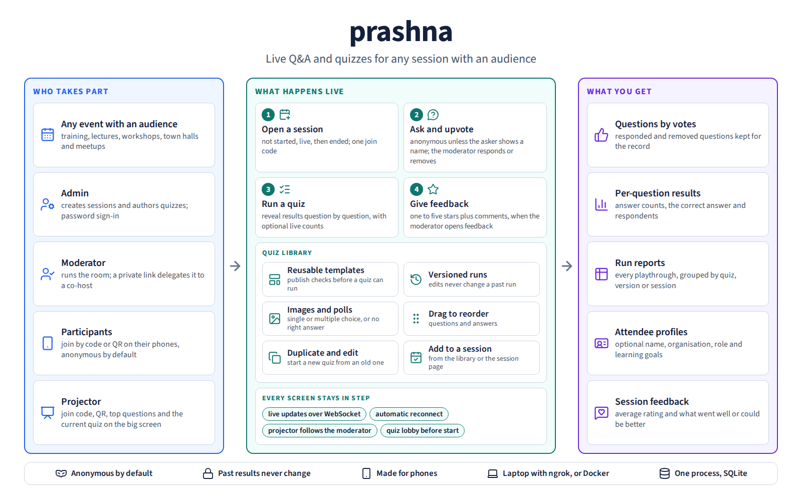

# Prashna



*How prashna runs a session with an audience: an admin sets it up, a moderator runs the room, participants join on their phones and the projector shows the room the same state. Questions are asked and upvoted, versioned quizzes are run question by question, and the session ends with ranked questions, quiz results, run reports, attendee profiles and feedback. The [infographic source](docs/images/prashna-infographic.html) is kept with the image.*

A live Q&A and quiz tool for any session with an audience — training,
lectures, workshops, town halls, meetups. *Prashna* (प्रश्न) is
Sanskrit for *question*.

Two core features:

- **Anonymous Q&A** — participants post queries, upvote each other,
  moderator responds (text or verbal). Removed queries are
  soft-deleted (kept for audit, hidden from participants).
- **Moderator-conducted quizzes** — single- or multi-choice
  questions, optional images, anonymous voting, per-question
  reveal, lobby state on the projector, optional live counts
  during voting. Quizzes are versioned: editing a template never
  alters a past run's report.

Plus a **projector view** for the big screen at the front of the
room: join code, scannable QR for the participant URL (admin can
override the base URL per session), top queries, and the current
quiz in lockstep with the moderator.

## Quick start

```bash
uv sync
npm ci
npm run build
uv run uvicorn app.main:app --reload --port 8000
```

On its first start the server prints a one-time setup link in its log:

```text
No admin yet. Create one by opening this one-time link on this server's address: /#setup=...
```

Open <http://localhost:8000/#setup=...> (the server's address plus that
path) and choose a username and password. The link works once; after that,
sign in to create sessions and author quizzes. Only someone who can see the
server's log can create the admin, so it is safe even if the address is
already public.

### Run locally and share through ngrok

The original no-server-deployment workflow is still supported. Build the
frontend, then start Prashna on localhost:

```bash
uv sync
npm ci
npm run build
export PRASHNA_TRUSTED_PROXY_HOPS=1
uv run uvicorn app.main:app --host 127.0.0.1 --port 8000
```

Open the setup link from the log if this is the first start. In another
terminal, start the tunnel:

```bash
ngrok http 8000
```

Share the HTTPS URL ngrok prints. The same endpoint carries normal HTTP and
secure WebSocket traffic, so participant, moderator, and projector live
updates do not need a second tunnel. Keep the Uvicorn process to one worker:
Prashna's WebSocket hub is in-memory and intentionally single-process.

An opt-in end-to-end smoke test exercises this exact flow with an isolated
database and a real temporary ngrok endpoint (the ngrok CLI must already be
installed and authenticated):

```bash
PRASHNA_NGROK_SMOKE=1 uv run pytest tests/ops/test_ngrok_smoke.py
```

Admin sign-ins survive restarts without configuration: the server keeps its
signing key in `secret-key` beside the database. Set `PRASHNA_SECRET_KEY`
only to choose the key yourself.

## Roles

| Role        | URL                  | Auth                                  |
| ----------- | -------------------- | ------------------------------------- |
| Admin       | `/`                  | Cookie (bcrypt password, signed)      |
| Moderator   | `/m/<code>`          | Admin cookie OR `mod_key` URL frag    |
| Participant | `/s/<code>`          | Anonymous (`voter_token` cookie)      |
| Projector   | `/p/<code>`          | Public, read-only                     |
| Quiz library| `/quizzes`           | Admin cookie                          |

**Admin ⊇ Moderator**: the admin who owns a session reaches the
moderator UI directly with their cookie. The `mod_key` (delivered
via `/m/<code>#k=<key>` URL) is the *delegation* mechanism —
hand it to a TA / co-host who has no admin account.

Interactive role pages include breadcrumbs and section jump links. An
admin who opens a session from the session list lands on that session's
page, which carries every moderator control plus owner-only settings. The
quiz library's run report can be viewed
flat or grouped by quiz, immutable quiz version, or session. The projector
deliberately remains chrome-free for presentation use.

## Entities

| Entity              | What it is                                                     |
| ------------------- | -------------------------------------------------------------- |
| `User`              | The admin. Single global today; SSO-based multi-admin planned. |
| `Session`           | A live event. Lifecycle: `planning → live → ended`.            |
| `Participant`       | Per-session anonymous identity, keyed by `voter_token` cookie. |
| `Query`             | A participant-asked Q&A entry. Has votes and an optional response. |
| `Quiz`              | Reusable quiz template owned by a User. Lifecycle: `draft → ready`. |
| `Question` / `Answer` | One quiz question and one answer choice in the template.     |
| `QuizVersion`       | Immutable snapshot of a Quiz captured on Launch. Historical reports point to versions, never to the editable template. |
| `QuizRun`           | One playthrough of a `QuizVersion` inside a Session. Lifecycle: `queued → live → closed`. At most one `live` per Session, enforced by a partial unique index. |
| `QuizSubmission`    | A participant's selected `Answer`(s) for a `Question` in a `QuizRun`. |

For the full data model, lifecycles, and authoritative behavior
spec, see [`docs/specs.md`](docs/specs.md). For the frontend design
system, see [`docs/UX.md`](docs/UX.md).

## Documentation

Tracked documentation is maintained as a **live** description of the current
product and its operation:

- `docs/specs.md` and `docs/UX.md` own detailed behavior and frontend rules.
- `spec.md` and `design.md` are the system-level requirements and design views;
  they summarize rather than duplicate the detailed use-case contract.
- `performance/README.md`, `deploy/README.md`, and
  `distribution/README.md` are the focused operator runbooks.
- `docs/todo.md` contains only current engineering follow-ups. Product ideas
  awaiting decisions remain in the deferred appendix of `docs/specs.md`.

One-off reviews, assessments, completed plans, proposals, generated reports,
and dated investigations are immutable local records, not live project
documentation. Keep them outside Git tracking and add their exact paths to
`.git/info/exclude`; do not keep revising or recommitting them.

## Live updates

Every page opens a WebSocket to `/ws/sessions/<code>`. State-changing
actions broadcast a short `{"type": "..."}` hint; clients refetch
on receipt. Kinds: `session_state`, `participant`, `query_*`,
`quiz_run_*`, `quiz_submission`. Auto-reconnect with exponential
backoff if the socket drops.

## Tests

500+ tests against `docs/specs.md`:

```bash
uv run pytest               # full suite (~2 min)
uv run pytest tests/api/    # API only (pytest + httpx + TestClient)
uv run pytest tests/ui/     # UI only (Playwright Python)
```

UI tests need Chromium installed once:

```bash
uv run playwright install chromium
```

Every UC in the spec has `Tests (API)` and/or `Tests (UI)` bullets
that map 1:1 to a pytest function.

## Environment

- `PRASHNA_SECRET_KEY` — optional cookie-signing key. Without it the
  server creates one in `secret-key` beside the database and reuses it.
- `PRASHNA_SETUP_TOKEN` — optional fixed first-admin setup token. Without
  it the server generates one and prints the setup link at start.
- `PRASHNA_DB_PATH` — override DB location (default
  `<repo>/prashna.db`). Used by Docker and tests.
- `PRASHNA_UPLOADS_DIR` — override uploads dir.

## Diagnostics

Prashna emits structured operator diagnostics through the Python `prashna`
logger. Records use `diag_event` plus safe context such as outcome, route
area, row ids, session code, and upload size or extension. They deliberately
omit passwords, cookies, OAuth tokens, moderator keys, participant contact
fields, uploaded bytes, filenames, and user-entered Q&A text.

Production operators should retain application or container logs for at least
7 days. Retention is owned by the host log driver, journald policy, or external
log shipper; Prashna does not store diagnostic logs in the SQLite database.

## Project layout

```
app/                FastAPI app — routes, models, auth, db, websocket hub
frontend/          Vite + TypeScript frontend, one page per role
  src/              shared TS helpers, page entries, and app.css tokens
  public/vendor/    vendored QR lib
docs/
  specs.md          Use-case spec + acceptance tests — authoritative
  UX.md             Frontend design system — authoritative
tests/
  api/              pytest + httpx + FastAPI TestClient
  ui/               Playwright Python
Dockerfile          production image build
deploy/             Hetzner Compose, nginx, TLS and Cloudflare helpers
uploads/            user-uploaded images (gitignored)
compose.yaml        laptop/self-host distribution using the published image
compose.env.example configuration template for the local Compose bundle
```

## Distribution

The canonical runnable artifact is the multi-architecture image at
`ghcr.io/kvsankar/prashna`. The root [`compose.yaml`](compose.yaml) is the
laptop/small-host distribution; the separate `deploy/` configuration remains
specific to the Hetzner production service.

For a local container installation:

```bash
docker compose up -d --wait
docker compose logs prashna | grep setup=
```

Open <http://127.0.0.1:8000/> plus the `/#setup=...` path from the log and
create the first admin. A `.env` (from `compose.env.example`) is optional. Database and uploads
live in named volumes and survive container replacement. Do not run
`docker compose down --volumes` unless you intend to delete them.

Version tags publish `linux/amd64` and `linux/arm64` images, smoke-test the
exact pushed digest, and attach version-pinned `.zip` and `.tar.gz` Compose
bundles plus `SHA256SUMS` to the matching GitHub Release. See
[`distribution/README.md`](distribution/README.md) for ngrok, backup, restore,
upgrade, registry access, and operational commands. Broad anonymous
distribution also requires the GHCR package visibility to be set to Public in
GitHub Packages; that account-level setting is intentionally not controlled by
the repository workflow.

## Deploy

There's a Dockerfile and a `deploy/` kit for a Hetzner VPS behind
nginx with Certbot/Let's Encrypt. Images publish to
`ghcr.io/kvsankar/prashna` via the `.github/workflows/docker.yml`
workflow on each push to `main` and version tags. See
[`deploy/README.md`](deploy/README.md).

## Status

Prashna has a live single-operator production deployment at
`prashna.sankara.net` and a versioned multi-architecture container release.
`init_db()` creates fresh schemas and runs the additive SQLite migration bridge
for known post-deploy columns/indexes. Breaking schema
changes still require an explicit release note or a real migration before
they can safely reach persistent installations. Broader open-source
distribution and a hosted SaaS variant remain future directions. See the
**Deferred (decision needed)** appendix at the bottom of
`docs/specs.md` for items that need product calls before they ship:
SSO, multi-admin, reopen lifecycles, per-question timer,
content-sniffing on uploads, etc.
