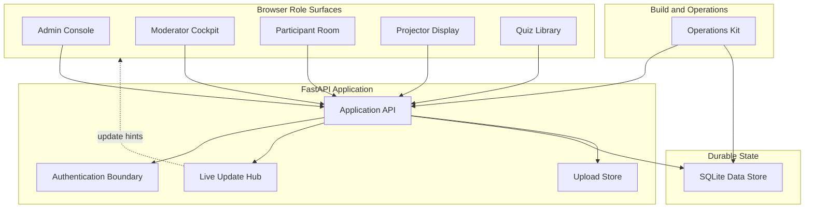
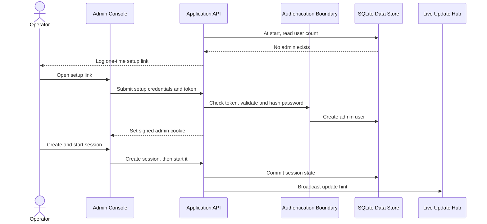
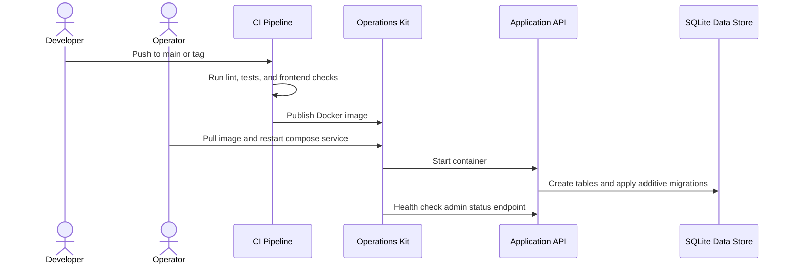
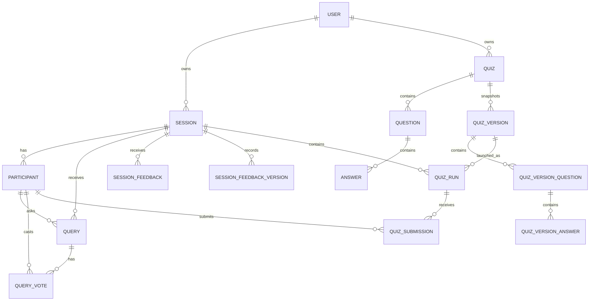

<!-- sarathi:artifact-format version="2" -->

# Prashna Software Design Document

## Technical Approach

Prashna stays a single FastAPI application serving browser role pages, JSON
APIs, WebSocket update hints, uploaded media, and the built Vite frontend.
Durable state remains in one SQLite database and one uploads directory. The
accepted target is not a redesign; it is a clearer brownfield baseline with
privacy-safe diagnostics, external test traceability, deployment smoke evidence,
and focused regression coverage around live-room behavior.

Shared responsibilities stay simple. The browser role surfaces render workflows
and recover through HTTP refetch after update hints. The application boundary
owns validation, authorization, state mutation, serialization, and safe error
responses. The data and uploads boundaries persist state and files. Operations
owns local commands, CI, Docker Compose deployment, health checks, and runbook
evidence. Distributed live updates, Alembic, hosted telemetry, dashboards,
alerts, and multi-tenant administration remain outside this design until a
later accepted delta requires them.

## Overview

Prashna is a single-process live Q&A and quiz application for training
sessions, lectures, and workshops. The system boundary is one FastAPI
application that serves role pages, JSON APIs, WebSocket update hints, uploaded
media, and the built Vite frontend; one SQLite database stores durable state;
one uploads directory stores quiz images. The design strategy is to keep the
runtime operationally small while making live-room state, historical quiz
reports, security boundaries, and deployment behavior explicit.

Work Scope: product/system.

Design Depth: HLD.

Ready To Implement: Yes; the described baseline is implemented.

Review Level: Standard.

Extra Checks: Security, Privacy and compliance, Reliability and operations,
Build and release, Documentation, UI and accessibility.

## Tech Stack

- Backend: Python 3.11 or newer, FastAPI, SQLAlchemy 2 sync ORM, SQLite,
  uvicorn.
- Authentication and authorization: bcrypt password hashes, itsdangerous signed
  admin cookies, optional allowlisted GitHub OAuth, per-session moderator keys,
  participant voter-token cookies, and in-process token-bucket throttles.
- Live updates: FastAPI WebSocket endpoint with an in-process room hub keyed by
  session code.
- Frontend: Vite, TypeScript ES modules, plain HTML, shared CSS, one entry point
  per role surface, and no frontend framework.
- Persistence: one SQLite database file plus an uploads directory. Docker maps
  both to host volumes.
- Verification: pytest/httpx API tests, Playwright browser tests, Ruff, ESLint,
  Stylelint, TypeScript type checking, and GitHub Actions.
- Deployment: Docker image published to GHCR, docker compose on the host, nginx
  as TLS reverse proxy behind Cloudflare, and a health check against
  `/api/admin/status`.

## Drivers & Constraints

- Product scope: support the current admin, moderator, participant, projector,
  quiz authoring, reporting, and operator workflows from UN-PARTICIPANT-ASK
  through UN-DEVELOPER-CONTRACT.
- Live-room correctness: state mutations commit before update hints, and clients
  recover by HTTP refetch, satisfying FR-LIVE-BROADCAST, FR-LIVE-RECONNECT,
  NFR-RELY-LIVEUPDATES, and JT-ROOM-LIVE.
- Historical integrity: quiz runs reference immutable quiz-version snapshots,
  satisfying FR-QUIZ-VERSION, NFR-RELY-HISTORY, and JT-QUIZ-HISTORY.
- Deployment simplicity: the baseline uses one FastAPI process, one SQLite
  database, one uploads directory, and one in-memory live-update hub, satisfying
  FR-OPS-CONFIG, FR-OPS-DEPLOY, and NFR-DATA-PERSISTENCE.
- Security boundaries: admin cookies, moderator keys, participant tokens, upload
  limits, security headers, OAuth allowlists, and rate limits must remain
  explicit for FR-AUTH-BOOTSTRAP, FR-MOD-ACCESS, FR-QUIZ-UPLOAD,
  NFR-SEC-HEADERS, NFR-SEC-UPLOADS, and NFR-RATE-LIMIT.
- Documentation and build constraints: behavior docs, local commands, CI checks,
  Docker image publication, and deployment files remain part of the design
  baseline for NFR-BUILD-CHECKS and NFR-DOCS-TRACE.
- Brownfield constraint: this document describes the accepted current baseline.
  Large rewrites, frontend-framework migration, distributed pub-sub, Alembic,
  and multi-tenant SaaS controls require later child specs.

## Layers

- Browser Role Surfaces
  - Responsibility: render admin, moderator, participant, projector, and quiz
    authoring workflows.
  - Boundary: depends on same-origin HTTP, WebSocket hints, browser storage, and
    static assets; it does not own durable business state.
  - Classification: presentation shell.
  - Requirements: UC-AUTH-BOOTSTRAP, UC-SESSION-ADMIN, UC-MOD-RUNROOM,
    UC-PARTICIPANT-QA, UC-PARTICIPANT-QUIZ, UC-PARTICIPANT-FEEDBACK,
    UC-DISPLAY-PROJECTOR, and UC-LIVE-SYNC.
- FastAPI Application Boundary
  - Responsibility: serve pages, JSON APIs, uploads, update sockets,
    serializers, validation, auth dependencies, and safe error responses.
  - Boundary: coordinates stateful operations and commits, then publishes update
    hints through the live-update boundary.
  - Classification: application orchestration plus adapter shell.
  - Requirements: FR-AUTH-LOGIN, FR-SESSION-CREATE, FR-QA-ASK,
    FR-RUN-SUBMIT, FR-FEEDBACK-SUBMIT, FR-LIVE-BROADCAST, and
    FR-OPS-CONFIG.
- Live-Room Rules
  - Responsibility: define lifecycle rules, participant identity, Q&A ranking,
    feedback aggregation, quiz validation, quiz-version capture, quiz-run state
    transitions, result tallying, and display state.
  - Boundary: should remain testable through API and browser flows even when the
    rules live inside the current route module.
  - Classification: core policy and application orchestration.
  - Requirements: FEAT-SESSION-MANAGE, FEAT-QA-LIVE, FEAT-QUIZ-AUTHOR,
    FEAT-QUIZ-RUN, FEAT-FEEDBACK-RATE, and FEAT-DISPLAY-ROOM.
- Durable State
  - Responsibility: store users, sessions, participants, questions, feedback,
    quiz templates, quiz versions, quiz runs, submissions, indexes, migrations,
    and uploaded media references.
  - Boundary: accessed through SQLAlchemy sessions and filesystem upload paths.
  - Classification: data and infrastructure.
  - Requirements: FR-QUIZ-VERSION, FR-OPS-MIGRATE, NFR-DATA-PERSISTENCE, and
    NFR-SCHEMA-MIGRATION.
- Build, Release, and Operations
  - Responsibility: define local commands, CI gates, image build, compose
    deployment, nginx fronting, environment variables, health checks, and docs.
  - Boundary: controls how the application is built, configured, deployed, and
    verified, but not live production actions without explicit instruction.
  - Classification: infrastructure and operations.
  - Requirements: UC-OPS-DEPLOY, FEAT-OPS-BASELINE, AT-BUILD-CHECKS,
    AT-OPS-DEPLOY, and AT-DOCS-TRACE.

## Components

The component diagram uses readable labels as primary text. The glossary below
maps each readable label to its stable trace ID.



Readable component responsibilities:

- Admin Console handles setup, admin authentication, owned sessions, and owner
  actions.
- Moderator Cockpit handles delegated live-room control, Q&A triage, quiz
  playback, and feedback summaries.
- Participant Room handles anonymous identity, explicit profile submission,
  questions, votes, quiz answers, optional profile photographs, and
  moderator-enabled feedback.
- Projector Display presents public join details and current room state.
- Quiz Library handles reusable templates, image attachment, validation,
  publication, and immutable launch snapshots.
- Application API coordinates HTTP routes, validation, commits, serialization,
  and live update hints.
- Authentication Boundary handles admin cookies, OAuth, moderator keys,
  participant tokens, password checks, and throttling.
- Live Update Hub manages WebSocket rooms and hint delivery.
- SQLite Data Store owns relational persistence and additive migrations.
- Upload Store writes bounded image files and serves upload URLs.
- Operations Kit covers local commands, CI, Docker, deployment files, health
  checks, and behavior-doc contracts.

<!-- sarathi:entity id="LAYER-CLIENT" type="layer" name="Browser Role Surfaces" refs="UC-AUTH-BOOTSTRAP UC-SESSION-ADMIN UC-MOD-RUNROOM UC-PARTICIPANT-QA UC-PARTICIPANT-QUIZ UC-PARTICIPANT-FEEDBACK UC-DISPLAY-PROJECTOR UC-LIVE-SYNC" -->
<!-- sarathi:entity id="LAYER-API" type="layer" name="FastAPI Application Boundary" refs="FR-AUTH-LOGIN FR-SESSION-CREATE FR-QA-ASK FR-RUN-SUBMIT FR-FEEDBACK-SUBMIT FR-LIVE-BROADCAST FR-OPS-CONFIG" -->
<!-- sarathi:entity id="LAYER-DOMAIN" type="layer" name="Live-Room Rules" refs="FEAT-SESSION-MANAGE FEAT-QA-LIVE FEAT-QUIZ-AUTHOR FEAT-QUIZ-RUN FEAT-FEEDBACK-RATE FEAT-DISPLAY-ROOM" -->
<!-- sarathi:entity id="LAYER-DATA" type="layer" name="Durable State" refs="FR-QUIZ-VERSION FR-OPS-MIGRATE NFR-DATA-PERSISTENCE NFR-SCHEMA-MIGRATION" -->
<!-- sarathi:entity id="LAYER-OPS" type="layer" name="Build, Release, and Operations" refs="UC-OPS-DEPLOY FEAT-OPS-BASELINE AT-BUILD-CHECKS AT-OPS-DEPLOY AT-DOCS-TRACE" -->
<!-- sarathi:entity id="COMP-ADMIN" type="component" name="Admin Console" refs="LAYER-CLIENT LAYER-API IFACE-HTTP IFACE-GITHUB FR-AUTH-BOOTSTRAP FR-AUTH-LOGIN FR-AUTH-GITHUB FR-AUTH-PASSWORD FR-SESSION-CREATE FR-SESSION-METADATA FR-SESSION-LIFECYCLE FR-SESSION-DELETE UC-AUTH-BOOTSTRAP UC-SESSION-ADMIN" -->
<!-- sarathi:entity id="COMP-MODERATOR" type="component" name="Moderator Cockpit" refs="LAYER-CLIENT LAYER-DOMAIN IFACE-HTTP IFACE-WEBSOCKET FR-MOD-ACCESS FR-QA-RESPOND FR-QA-REMOVE FR-RUN-QUEUE FR-RUN-PROGRESS FR-FEEDBACK-SUMMARY UC-MOD-RUNROOM AT-MOD-ACCESS" -->
<!-- sarathi:entity id="COMP-PARTICIPANT" type="component" name="Participant Room" refs="LAYER-CLIENT LAYER-DOMAIN IFACE-HTTP IFACE-WEBSOCKET FR-QA-IDENTITY FR-QA-ASK FR-QA-VOTE FR-QA-SORT FR-RUN-SUBMIT FR-RUN-RESULTS FR-FEEDBACK-SUBMIT UC-PARTICIPANT-QA UC-PARTICIPANT-QUIZ UC-PARTICIPANT-FEEDBACK" -->
<!-- sarathi:entity id="COMP-PROJECTOR" type="component" name="Projector Display" refs="LAYER-CLIENT IFACE-HTTP IFACE-WEBSOCKET IFACE-STATIC FR-DISPLAY-JOIN FR-DISPLAY-QUIZ FR-RUN-RESULTS UC-DISPLAY-PROJECTOR AT-DISPLAY-JOIN AT-DISPLAY-QUIZ" -->
<!-- sarathi:entity id="COMP-QUIZLIB" type="component" name="Quiz Library" refs="LAYER-CLIENT LAYER-DOMAIN LAYER-DATA IFACE-HTTP IFACE-UPLOADS IFACE-SQLITE FR-QUIZ-TEMPLATE FR-QUIZ-PUBLISH FR-QUIZ-UPLOAD FR-QUIZ-VERSION UC-QUIZ-AUTHOR AT-QUIZ-TEMPLATE AT-QUIZ-VERSION" -->
<!-- sarathi:entity id="COMP-API" type="component" name="Application API" refs="LAYER-API FR-SESSION-CREATE FR-QA-ASK FR-RUN-PROGRESS FR-FEEDBACK-SUMMARY FR-LIVE-BROADCAST NFR-ERROR-FEEDBACK NFR-SEC-HEADERS" -->
<!-- sarathi:entity id="COMP-AUTH" type="component" name="Authentication Boundary" refs="LAYER-API LAYER-DOMAIN IFACE-HTTP IFACE-GITHUB IFACE-SQLITE FR-AUTH-BOOTSTRAP FR-AUTH-LOGIN FR-AUTH-GITHUB FR-AUTH-PASSWORD FR-MOD-ACCESS FR-QA-IDENTITY NFR-SEC-PASSWORDS NFR-PRIVACY-ANON NFR-RATE-LIMIT" -->
<!-- sarathi:entity id="COMP-LIVE" type="component" name="Live Update Hub" refs="LAYER-API IFACE-WEBSOCKET FR-LIVE-BROADCAST FR-LIVE-RECONNECT NFR-RELY-LIVEUPDATES UC-LIVE-SYNC AT-LIVE-BROADCAST AT-LIVE-RECONNECT" -->
<!-- sarathi:entity id="COMP-DATA" type="component" name="SQLite Data Store" refs="LAYER-DATA IFACE-SQLITE FR-SESSION-DELETE FR-QUIZ-VERSION FR-RUN-SUBMIT FR-OPS-MIGRATE NFR-DATA-PERSISTENCE NFR-SCHEMA-MIGRATION NFR-RELY-HISTORY" -->
<!-- sarathi:entity id="COMP-UPLOADS" type="component" name="Upload Store" refs="LAYER-DATA LAYER-API IFACE-UPLOADS FR-QUIZ-UPLOAD NFR-SEC-UPLOADS UC-QUIZ-AUTHOR AT-QUIZ-UPLOAD AT-NFR-ERRORS" -->
<!-- sarathi:entity id="COMP-OPS" type="component" name="Operations Kit" refs="LAYER-OPS IFACE-STATIC IFACE-HTTP IFACE-SQLITE FR-OPS-CONFIG FR-OPS-DEPLOY FR-OPS-MIGRATE UC-OPS-DEPLOY NFR-BUILD-CHECKS NFR-DIAG-SUPPORT NFR-DOCS-TRACE" -->

## Interfaces

The main runtime interfaces are the same-origin HTTP API, the session update
socket, SQLite persistence, image uploads, optional GitHub admin OAuth, and
static assets/media serving.

- Same-Origin HTTP API: browser clients call page routes and JSON routes under
  `/api/*`; admin routes require signed cookies, moderator routes accept owner
  cookies or the moderator key, and participant routes resolve voter-token
  cookies.
- Session Update Socket: browsers connect to `/ws/sessions/{code}` for small
  update hints, then refetch authoritative state over HTTP.
- SQLite Persistence: route handlers access SQLite through SQLAlchemy sessions,
  foreign keys, WAL mode, busy timeout, relationship cascades, indexes, and
  startup migration bridges.
- Image Upload Boundary: authenticated admins post bounded image files and
  receive upload URLs for quiz content.
- GitHub Admin OAuth: optional OAuth routes redirect through the configured
  GitHub app, enforce allowlists, resolve the admin identity, and issue the same
  admin cookie.
- Static Assets and Media: FastAPI serves the built Vite app, vendor assets, and
  uploaded media from configured paths.

<!-- sarathi:entity id="IFACE-HTTP" type="interface" name="Same-Origin HTTP API" owner="COMP-API" refs="FR-AUTH-LOGIN FR-MOD-ACCESS FR-QA-ASK FR-RUN-SUBMIT FR-FEEDBACK-SUBMIT NFR-ERROR-FEEDBACK NFR-SEC-HEADERS" -->
<!-- sarathi:entity id="IFACE-WEBSOCKET" type="interface" name="Session Update Socket" owner="COMP-LIVE" refs="FR-LIVE-BROADCAST FR-LIVE-RECONNECT NFR-RELY-LIVEUPDATES UC-LIVE-SYNC" -->
<!-- sarathi:entity id="IFACE-SQLITE" type="interface" name="SQLite Persistence" owner="COMP-DATA" refs="FR-QUIZ-VERSION FR-OPS-MIGRATE NFR-DATA-PERSISTENCE NFR-SCHEMA-MIGRATION" -->
<!-- sarathi:entity id="IFACE-UPLOADS" type="interface" name="Image Upload Boundary" owner="COMP-UPLOADS" refs="FR-QUIZ-UPLOAD NFR-SEC-UPLOADS" -->
<!-- sarathi:entity id="IFACE-GITHUB" type="interface" name="GitHub Admin OAuth" owner="COMP-AUTH" refs="FR-AUTH-GITHUB AT-AUTH-GITHUB" -->
<!-- sarathi:entity id="IFACE-STATIC" type="interface" name="Static Assets and Media" owner="COMP-OPS" refs="FR-OPS-DEPLOY NFR-BUILD-CHECKS AT-OPS-DEPLOY" -->

## Core vs. Shell / Equivalent Separation

The current codebase uses a pragmatic route module rather than a formal
hexagonal package layout. The equivalent separation is by responsibility:

| Area | Classification | Test focus |
| --- | --- | --- |
| Admin Console | Presentation plus orchestration | Auth and owner workflows. |
| Moderator Cockpit | Presentation plus orchestration | Delegated room controls. |
| Participant Room | Presentation plus orchestration | Q&A, quiz, and feedback flows. |
| Projector Display | Presentation | Public read-only state and accessibility. |
| Quiz Library | Mixed policy and presentation | Template validation and version history. |
| Application API | Application shell | Route contracts, commits, broadcasts, and errors. |
| Authentication Boundary | Mixed policy and shell | Cookie, OAuth, key, token, and rate-limit checks. |
| Live Update Hub | Adapter shell | Socket fanout, reconnect, and refetch behavior. |
| SQLite Data Store | Data infrastructure | Persistence, migrations, and history. |
| Upload Store | Adapter shell | Upload limits, file writes, and URL serving. |
| Operations Kit | Infrastructure | Build, CI, deployment, health, and docs checks. |

Core rules include authorization predicates, participant resolution,
serializers, quiz publishability validation, quiz-version capture, quiz-run
transition checks, Q&A visibility rules, feedback aggregation, result tallying,
and migration bridge rules.

Shell adapters include FastAPI route functions, cookie and header dependencies,
SQLAlchemy sessions, WebSocket accept/send calls, upload file IO, static-file
serving, GitHub redirect/callback handling, Docker compose, and GitHub Actions.

The boundary rule is that route handlers may orchestrate HTTP dependencies and
commits, but durable business behavior must stay verifiable through API and
browser flows tied to AT-* and JT-* identifiers.

## Key Flows

Admin bootstrap and session start:



Live Q&A and refetch recovery:

```mermaid
sequenceDiagram
  actor Participant
  actor Moderator
  participant Room as Participant Room
  participant Cockpit as Moderator Cockpit
  participant API as Application API
  participant Data as SQLite Data Store
  participant Live as Live Update Hub

  Participant->>Room: Submit question
  Room->>API: Create question
  API->>Data: Persist query
  API->>Live: Broadcast Q&A hint
  Live-->>Cockpit: Update hint
  Cockpit->>API: Refetch questions
  Moderator->>Cockpit: Mark responded
  Cockpit->>API: Respond to question
  API->>Data: Commit response
  API->>Live: Broadcast Q&A hint
  Live-->>Room: Update hint
  Room->>API: Refetch questions
```

Quiz launch, snapshot, and results:

```mermaid
sequenceDiagram
  actor Admin
  actor Moderator
  actor Participant
  participant Library as Quiz Library
  participant Cockpit as Moderator Cockpit
  participant API as Application API
  participant Data as SQLite Data Store
  participant Display as Projector Display

  Admin->>Library: Publish valid quiz
  Library->>API: Save template state
  API->>Data: Persist editable quiz
  Moderator->>Cockpit: Queue quiz in session
  Cockpit->>API: Launch ready quiz
  API->>Data: Capture or reuse quiz version
  API->>Data: Create quiz run
  Participant->>API: Submit answer
  API->>Data: Persist submission
  Moderator->>Cockpit: Reveal results
  Cockpit->>API: Reveal current question
  Display->>API: Refetch public quiz state
```

Operations release and startup migration:



## Data Model



- User: admin identity with username, password hash, optional GitHub id,
  session version, and creation time. Supports FR-AUTH-BOOTSTRAP,
  FR-AUTH-LOGIN, FR-AUTH-GITHUB, and FR-AUTH-PASSWORD.
- Session: live event with code, title, moderator key, owner, lifecycle status,
  participant base URL, feedback-enabled flag, timestamps, queries, quiz runs,
  participants, feedback, and feedback versions. Supports FR-SESSION-CREATE,
  FR-SESSION-LIFECYCLE, FR-MOD-ACCESS, FR-DISPLAY-JOIN,
  FR-FEEDBACK-SUBMIT, and FR-SESSION-DELETE.
- Participant: per-session anonymous identity keyed by voter token, optional
  profile fields, optional photograph URL, and seen timestamps. Supports
  FR-QA-IDENTITY,
  FR-FEEDBACK-SUBMIT, and NFR-PRIVACY-ANON.
- Query and QueryVote: Q&A board entries with text, optional response,
  soft-removal timestamp, participant author, and one vote row per participant.
  Supports FR-QA-ASK, FR-QA-VOTE, FR-QA-SORT, FR-QA-RESPOND, and
  FR-QA-REMOVE.
- SessionFeedback and SessionFeedbackVersion: participant rating and comments,
  plus submitted versions for reporting context. Supports FR-FEEDBACK-SUBMIT
  and FR-FEEDBACK-SUMMARY.
- Quiz, Question, and Answer: editable reusable quiz template tree with owner,
  publish status, edited timestamp, prompt text, optional image URLs,
  single/multi type, graded flag, answer correctness, and ordering. Supports
  FR-QUIZ-TEMPLATE, FR-QUIZ-PUBLISH, and FR-QUIZ-UPLOAD.
- QuizVersion, QuizVersionQuestion, and QuizVersionAnswer: denormalized,
  immutable snapshots used by launched runs. Supports FR-QUIZ-VERSION,
  NFR-RELY-HISTORY, and JT-QUIZ-HISTORY.
- QuizRun and QuizSubmission: one playthrough of a QuizVersion inside a
  Session, with queued/live/closed status, current question index, reveal and
  live-count flags, timestamps, and participant answer selections. Supports
  FR-RUN-QUEUE, FR-RUN-PROGRESS, FR-RUN-SUBMIT, and FR-RUN-RESULTS.
- Upload files: image blobs stored outside SQLite and referenced by URL from
  quiz questions, answers, or participant profile photographs. Supports
  FR-QUIZ-UPLOAD, FR-QA-IDENTITY, and NFR-SEC-UPLOADS.

SQLite uses foreign-key enforcement, WAL mode, busy timeout, synchronous normal
mode, cascade relationships where deletion should remove child records, and
known additive migration DDL for post-deploy columns and indexes.

## Design Decisions

- DEC-SINGLEPROCESS: Single-Process Runtime
  - Decision: keep one FastAPI process, one SQLite database, one uploads
    directory, one in-memory live-update hub, and in-process rate limiting.
  - Alternatives: split services with Redis pub-sub; use a managed relational
    datastore; run multiple FastAPI workers.
  - Rationale: matches the current 100-user room target with low operator
    burden and supports FR-OPS-DEPLOY, NFR-CAPACITY-ROOM, and
    NFR-DATA-PERSISTENCE.
  - Consequence: horizontal scale and distributed live updates require a future
    design.
  - Revisit trigger: sustained rooms exceed the single-process target or hosted
    SaaS scope is approved.
- DEC-HINTREFETCH: Hint Then Refetch
  - Decision: use WebSockets only for update hints and make HTTP the
    authoritative state interface.
  - Alternatives: stream full model state through sockets; poll all clients.
  - Rationale: reconnect behavior, missed messages, and client recovery stay
    straightforward while satisfying FR-LIVE-BROADCAST, FR-LIVE-RECONNECT, and
    NFR-RELY-LIVEUPDATES.
  - Consequence: clients perform more refetches, but state remains easier to
    validate.
  - Revisit trigger: refetch load violates NFR-PERF-INTERACTION or
    NFR-CAPACITY-ROOM.
- DEC-SQLITE: SQLite with Additive Startup Bridges
  - Decision: use SQLite with SQLAlchemy and startup additive migration bridges.
  - Alternatives: introduce Alembic now; move to PostgreSQL now.
  - Rationale: keeps local and hosted single-instance operations direct while
    satisfying FR-OPS-MIGRATE and NFR-SCHEMA-MIGRATION.
  - Consequence: breaking schema changes need an explicit release or migration
    plan.
  - Revisit trigger: data volume, concurrent writes, or schema evolution exceeds
    the bridge model.
- DEC-MULTIPAGE: Vite Multi-Page Frontend
  - Decision: keep Vite multi-page TypeScript with shared helpers and CSS.
  - Alternatives: migrate to React, Vue, Svelte, or a server-rendered template
    system.
  - Rationale: role surfaces remain small and align with existing docs and tests
    for UC-SESSION-ADMIN, UC-MOD-RUNROOM, UC-PARTICIPANT-QA, and
    UC-DISPLAY-PROJECTOR.
  - Consequence: shared UI patterns live in `common.ts`, `types.ts`, CSS, and
    docs rather than framework components.
  - Revisit trigger: UI complexity creates repeated maintenance risk that shared
    helpers no longer address.
- DEC-OWNERDELEGATE: Owner and Delegate Authority
  - Decision: model admin owners and delegate moderators separately.
  - Alternatives: create moderator accounts; make moderators full admins.
  - Rationale: satisfies UN-MODERATOR-RUN, FR-MOD-ACCESS, and owner-only session
    controls without adding account management.
  - Consequence: URL-fragment key handling and local storage remain part of the
    moderator client contract.
  - Revisit trigger: teams need revocable, audited, multi-person moderation.
- DEC-VERSIONEDQUIZ: Immutable Quiz Versions
  - Decision: launch quiz runs against immutable QuizVersion snapshots.
  - Alternatives: link runs to mutable templates; copy only report fields after
    closure.
  - Rationale: protects historical reporting and satisfies FR-QUIZ-VERSION,
    NFR-RELY-HISTORY, and JT-QUIZ-HISTORY.
  - Consequence: launch-time version capture must stay synchronized with
    template edit timestamps.
  - Revisit trigger: quiz authoring gains collaborative editing, imports, or
    richer media that changes snapshot semantics.

## Test Strategy

- TEST-AUTH-BOUNDARY
  - Kind: API, integration, and browser checks.
  - Covers: COMP-ADMIN, COMP-AUTH, COMP-API, IFACE-HTTP, IFACE-GITHUB,
    FR-AUTH-BOOTSTRAP, FR-AUTH-LOGIN, FR-AUTH-GITHUB, FR-AUTH-PASSWORD,
    FR-MOD-ACCESS, NFR-SEC-PASSWORDS, NFR-RATE-LIMIT, AT-AUTH-BOOTSTRAP,
    AT-AUTH-LOGIN, AT-AUTH-GITHUB, AT-AUTH-PASSWORD, AT-MOD-ACCESS, and
    AT-NFR-RATE.
  - Oracle: status codes, cookies, database rows, stale-cookie rejection,
    allowlist behavior, and visible auth state.
  - Environment: developer local and CI.
- TEST-SESSION-LIFECYCLE
  - Kind: API and browser journey checks.
  - Covers: COMP-ADMIN, COMP-MODERATOR, COMP-API, COMP-DATA, IFACE-HTTP,
    IFACE-SQLITE, FR-SESSION-CREATE, FR-SESSION-METADATA,
    FR-SESSION-LIFECYCLE, FR-SESSION-DELETE, AT-SESSION-CREATE,
    AT-SESSION-METADATA, AT-SESSION-LIFECYCLE, AT-SESSION-DELETE, and
    JT-ROOM-LIVE.
  - Oracle: persisted lifecycle state, owner-only mutation rejection, role page
    state, and deletion outcomes.
  - Environment: developer local and CI.
- TEST-QA-FLOW
  - Kind: API, browser, and workflow checks.
  - Covers: COMP-PARTICIPANT, COMP-MODERATOR, COMP-API, COMP-DATA,
    IFACE-HTTP, IFACE-SQLITE, FR-QA-IDENTITY, FR-QA-ASK, FR-QA-VOTE,
    FR-QA-SORT, FR-QA-RESPOND, FR-QA-REMOVE, NFR-PRIVACY-ANON,
    AT-QA-IDENTITY, AT-QA-ASK, AT-QA-VOTE, AT-QA-SORT, AT-QA-RESPOND,
    AT-QA-REMOVE, and JT-ROOM-LIVE.
  - Oracle: participant rows, visible query lists, vote counts, ranking order,
    response state, and moderator-only removed context.
  - Environment: developer local and CI.
- TEST-QUIZ-HISTORY
  - Kind: API, browser, upload, and historical-report checks.
  - Covers: COMP-QUIZLIB, COMP-MODERATOR, COMP-PARTICIPANT, COMP-DATA,
    COMP-UPLOADS, IFACE-HTTP, IFACE-SQLITE, IFACE-UPLOADS,
    FR-QUIZ-TEMPLATE, FR-QUIZ-PUBLISH, FR-QUIZ-UPLOAD, FR-QUIZ-VERSION,
    FR-RUN-QUEUE, FR-RUN-SUBMIT, FR-RUN-RESULTS, NFR-RELY-HISTORY,
    AT-QUIZ-TEMPLATE, AT-QUIZ-PUBLISH, AT-QUIZ-UPLOAD, AT-QUIZ-VERSION,
    AT-RUN-QUEUE, AT-RUN-SUBMIT, AT-RUN-RESULTS, and JT-QUIZ-HISTORY.
  - Oracle: quiz validation errors, uploaded URL shape, version rows, submitted
    answers, revealed results, and report stability after later edits.
  - Environment: developer local and CI.
- TEST-LIVE-REFRESH
  - Kind: WebSocket integration and browser recovery checks.
  - Covers: COMP-LIVE, COMP-API, COMP-MODERATOR, COMP-PARTICIPANT,
    COMP-PROJECTOR, IFACE-WEBSOCKET, IFACE-HTTP, FR-LIVE-BROADCAST,
    FR-LIVE-RECONNECT, NFR-RELY-LIVEUPDATES, AT-LIVE-BROADCAST,
    AT-LIVE-RECONNECT, and JT-OPS-RELEASE.
  - Oracle: update hint delivery, reconnect refetch behavior, and visible state
    refresh within the required window.
  - Environment: developer local and CI browser run.
- TEST-PROJECTOR-STATE
  - Kind: browser, accessibility, and display-state checks.
  - Covers: COMP-PROJECTOR, COMP-LIVE, COMP-API, IFACE-HTTP,
    IFACE-WEBSOCKET, FR-DISPLAY-JOIN, FR-DISPLAY-QUIZ, FR-RUN-RESULTS,
    NFR-ACCESS-KEYBOARD, NFR-UX-RESPONSIVE, AT-DISPLAY-JOIN,
    AT-DISPLAY-QUIZ, AT-NFR-ACCESS, and JT-ROOM-LIVE.
  - Oracle: DOM role/text output, QR/join details, quiz reveal state,
    keyboard operation, and mobile viewport behavior.
  - Environment: developer local and CI browser run.
- TEST-UPLOAD-SECURITY
  - Kind: API security and browser error checks.
  - Covers: COMP-UPLOADS, COMP-QUIZLIB, COMP-AUTH, COMP-API,
    IFACE-UPLOADS, IFACE-HTTP, FR-QUIZ-UPLOAD, NFR-SEC-UPLOADS,
    NFR-ERROR-FEEDBACK, AT-QUIZ-UPLOAD, and AT-NFR-ERRORS.
  - Oracle: accepted image URL, rejected type and size responses, auth
    enforcement, and safe user-visible error messages.
  - Environment: developer local and CI.
- TEST-SQLITE-MIGRATION
  - Kind: database migration and startup checks.
  - Covers: COMP-DATA, COMP-OPS, IFACE-SQLITE, IFACE-STATIC,
    FR-OPS-MIGRATE, FR-OPS-CONFIG, NFR-SCHEMA-MIGRATION,
    NFR-DATA-PERSISTENCE, AT-OPS-MIGRATE, AT-OPS-CONFIG, and
    JT-OPS-RELEASE.
  - Oracle: old-shape SQLite fixtures gain expected columns or indexes within
    the required startup window and preserve existing rows.
  - Environment: developer local and CI.
- TEST-DEPLOY-SMOKE
  - Kind: build, package, deployment, and health-check validation.
  - Covers: COMP-OPS, COMP-API, COMP-LIVE, COMP-DATA, IFACE-STATIC,
    IFACE-HTTP, IFACE-WEBSOCKET, IFACE-SQLITE, FR-OPS-DEPLOY,
    FR-OPS-CONFIG, NFR-BUILD-CHECKS, NFR-DIAG-SUPPORT, AT-BUILD-CHECKS,
    AT-OPS-DEPLOY, and JT-OPS-RELEASE.
  - Oracle: lint and test command success, frontend build output, Docker image
    build, compose health endpoint, persistent path configuration, and startup
    diagnostics.
  - Environment: CI and production-like operator host when explicitly requested.
- TEST-DOCS-CONTRACT
  - Kind: documentation and behavior-contract checks.
  - Covers: COMP-OPS, COMP-API, COMP-ADMIN, COMP-MODERATOR,
    COMP-PARTICIPANT, COMP-PROJECTOR, COMP-QUIZLIB, IFACE-HTTP,
    IFACE-STATIC, NFR-DOCS-TRACE, AT-DOCS-TRACE, AT-BUILD-CHECKS, and the
    traceability obligations in `spec.md`.
  - Oracle: docs mention the behavior under test, tests remain aligned with
    behavior specs, and stale references are caught during review.
  - Environment: developer local and CI where checks exist.

Test Environment Strategy:

- Developer local: `uv sync`, `npm install`, FastAPI on port 8000, Vite dev
  server, local SQLite database, local uploads directory, and test controlled
  environment variables. Runs API, browser, lint, type, migration, and docs
  checks selected for the change under review.
- CI: GitHub Actions installs Python and Node dependencies, runs Ruff, pytest
  with coverage, Playwright Chromium, ESLint, Stylelint, TypeScript checking,
  Docker build, and image publication on eligible refs.
- Production-like host: docker compose binds the app to localhost behind nginx,
  maps `/data` and `/uploads`, uses `/opt/prashna/.env`, and verifies health
  through `/api/admin/status`. Live production checks require explicit operator
  instruction.
- Deferred environments: shared integration, staging, synthetic monitoring, and
  production canary checks are not required for the current single-process
  baseline, but should be revisited before hosted SaaS or multi-tenant scope.

Context-Driven Review/Test Recommendations:

- Performance/load: rehearse or load-test the 100-user room target before
  public release pressure increases.
- Security: review bootstrap exposure, upload handling, cookies, OAuth
  allowlists, rate-limit proxy trust, and security headers before wider hosting.
- Privacy: preserve anonymous participant identity and avoid exposing
  unnecessary profile data.
- Accessibility and responsive UX: continue browser checks for role surfaces,
  especially participant and projector pages.
- Resilience and backup: define explicit SQLite and upload backup/restore
  rehearsal before relying on long-lived production data.
- Migration: keep old-shape SQLite regression coverage for every additive
  bridge change.

## Risks & Trade-offs

- RISK-BOOTSTRAP: First-Run Bootstrap Exposure
  - Impact: if the app is public before setup, the bootstrap endpoint could be
    claimed by the wrong user.
  - Likelihood: low; setup requires a one-time token that only appears in the
    server log, in an operator-set `PRASHNA_SETUP_TOKEN`, or in the
    `setup-token` file beside the database.
  - Mitigation: setup-token check on `POST /api/admin/setup`; the token is
    retired once an admin exists; GitHub sign-in stays allowlisted.
  - Owner: operator.
  - Trigger: a leaked server log or data folder before setup completes.
  - Residual risk: anyone who can read the server's logs or data folder before
    setup can create the admin.
- RISK-UPLOADS: Limited Upload Validation
  - Impact: extension and size checks do not prove image content safety.
  - Likelihood: medium if untrusted admins or public authoring are introduced.
  - Mitigation: require admin auth, cap size at 5 MB, keep upload tests, and
    treat content inspection as a future security hardening spec.
  - Owner: application maintainer.
  - Trigger: broader authoring roles or public upload exposure.
  - Residual risk: accepted for current admin-only baseline.
- RISK-MIGRATION: Narrow Migration Bridge
  - Impact: unsupported schema changes could require manual repair or an
    explicit migration plan.
  - Likelihood: medium as the product evolves.
  - Mitigation: update the additive bridge and old-shape SQLite tests for every
    supported persisted column or index.
  - Owner: developer making the schema change.
  - Trigger: non-additive schema changes or user-data retention commitments.
  - Residual risk: current design avoids Alembic until the need is explicit.
- RISK-WEBSOCKET: Single-Process Live Hub
  - Impact: multiple workers would split connected clients across independent
    room hubs.
  - Likelihood: low under current deployment, high if scaled without redesign.
  - Mitigation: keep deployment single-process, use HTTP refetch recovery, time
    out stalled sends, and require a future pub-sub design before scaling out.
  - Owner: operator and architecture maintainer.
  - Trigger: multiple workers, multiple hosts, or hosted SaaS deployment.
  - Residual risk: accepted for the current room-size target.
- RISK-OBSERVABILITY: Operator-Oriented Diagnostics
  - Impact: incident diagnosis may be slower than with structured telemetry and
    dashboards.
  - Likelihood: medium during production use.
  - Mitigation: preserve useful logs for auth, setup, OAuth, upload, migration,
    and startup paths; add structured telemetry through a future child spec when
    needed.
  - Owner: operator and maintainer.
  - Trigger: recurring live-event incidents or hosted support obligations.
  - Residual risk: current baseline favors low operational complexity.

## Traceability

- UN-PARTICIPANT-ASK: Participant Room, Application API, SQLite Data Store,
  IFACE-HTTP, TEST-QA-FLOW.
- UN-PARTICIPANT-SUPPORT: Participant Room, Application API, SQLite Data Store,
  IFACE-HTTP, TEST-QA-FLOW.
- UN-PARTICIPANT-IDENTITY: Participant Room, Authentication Boundary, SQLite
  Data Store, IFACE-HTTP, TEST-QA-FLOW.
- UN-PARTICIPANT-QUIZ: Participant Room, Moderator Cockpit, SQLite Data Store,
  IFACE-HTTP, TEST-QUIZ-HISTORY.
- UN-PARTICIPANT-FEEDBACK: Participant Room, Moderator Cockpit, SQLite Data
  Store, IFACE-HTTP, TEST-QA-FLOW.
- UN-MODERATOR-RUN: Moderator Cockpit, Authentication Boundary, Live Update Hub,
  IFACE-HTTP, IFACE-WEBSOCKET, TEST-SESSION-LIFECYCLE, TEST-LIVE-REFRESH.
- UN-MODERATOR-QA: Moderator Cockpit, Participant Room, Application API, SQLite
  Data Store, TEST-QA-FLOW.
- UN-MODERATOR-QUIZ: Moderator Cockpit, Quiz Library, SQLite Data Store, Live
  Update Hub, TEST-QUIZ-HISTORY, TEST-LIVE-REFRESH.
- UN-ADMIN-BOOTSTRAP: Admin Console, Authentication Boundary, Application API,
  IFACE-HTTP, IFACE-GITHUB, TEST-AUTH-BOUNDARY.
- UN-ADMIN-SESSIONS: Admin Console, Moderator Cockpit, SQLite Data Store,
  IFACE-HTTP, TEST-SESSION-LIFECYCLE.
- UN-ADMIN-QUIZZES: Quiz Library, Upload Store, SQLite Data Store, IFACE-HTTP,
  IFACE-UPLOADS, TEST-QUIZ-HISTORY, TEST-UPLOAD-SECURITY.
- UN-ADMIN-REPORTS: Admin Console, Moderator Cockpit, SQLite Data Store,
  IFACE-HTTP, TEST-QUIZ-HISTORY.
- UN-DISPLAY-JOIN: Projector Display, Live Update Hub, Application API,
  IFACE-HTTP, IFACE-WEBSOCKET, TEST-PROJECTOR-STATE.
- UN-DISPLAY-STATE: Projector Display, Live Update Hub, Moderator Cockpit,
  Participant Room, IFACE-WEBSOCKET, TEST-LIVE-REFRESH.
- UN-OPS-RUN: Operations Kit, Application API, SQLite Data Store, IFACE-STATIC,
  IFACE-SQLITE, TEST-DEPLOY-SMOKE.
- UN-OPS-SAFETY: Operations Kit, Authentication Boundary, Upload Store,
  IFACE-HTTP, IFACE-UPLOADS, TEST-AUTH-BOUNDARY, TEST-UPLOAD-SECURITY.
- UN-DEVELOPER-CONTRACT: Operations Kit, Application API, Quiz Library,
  IFACE-STATIC, TEST-DOCS-CONTRACT.

- FEAT-AUTH-ADMIN: COMP-ADMIN, COMP-AUTH, IFACE-HTTP, IFACE-GITHUB,
  DEC-OWNERDELEGATE, TEST-AUTH-BOUNDARY.
- FEAT-SESSION-MANAGE: COMP-ADMIN, COMP-MODERATOR, COMP-DATA, IFACE-HTTP,
  TEST-SESSION-LIFECYCLE.
- FEAT-MOD-DELEGATE: COMP-MODERATOR, COMP-AUTH, IFACE-HTTP,
  DEC-OWNERDELEGATE, TEST-AUTH-BOUNDARY.
- FEAT-QA-LIVE: COMP-PARTICIPANT, COMP-MODERATOR, COMP-DATA, COMP-LIVE,
  IFACE-HTTP, IFACE-WEBSOCKET, TEST-QA-FLOW.
- FEAT-QUIZ-AUTHOR: COMP-QUIZLIB, COMP-UPLOADS, COMP-DATA, IFACE-HTTP,
  IFACE-UPLOADS, DEC-VERSIONEDQUIZ, TEST-QUIZ-HISTORY.
- FEAT-QUIZ-RUN: COMP-MODERATOR, COMP-PARTICIPANT, COMP-PROJECTOR,
  COMP-DATA, COMP-LIVE, TEST-QUIZ-HISTORY, TEST-PROJECTOR-STATE.
- FEAT-FEEDBACK-RATE: COMP-PARTICIPANT, COMP-MODERATOR, COMP-DATA,
  IFACE-HTTP, TEST-QA-FLOW.
- FEAT-DISPLAY-ROOM: COMP-PROJECTOR, COMP-LIVE, IFACE-HTTP,
  IFACE-WEBSOCKET, TEST-PROJECTOR-STATE.
- FEAT-LIVE-REFRESH: COMP-LIVE, COMP-API, IFACE-WEBSOCKET, IFACE-HTTP,
  DEC-HINTREFETCH, TEST-LIVE-REFRESH.
- FEAT-OPS-BASELINE: COMP-OPS, COMP-DATA, COMP-AUTH, COMP-UPLOADS,
  IFACE-STATIC, IFACE-SQLITE, DEC-SINGLEPROCESS, DEC-SQLITE,
  TEST-DEPLOY-SMOKE.

- UC-AUTH-BOOTSTRAP: COMP-ADMIN, COMP-AUTH, IFACE-HTTP, IFACE-GITHUB,
  TEST-AUTH-BOUNDARY.
- UC-SESSION-ADMIN: COMP-ADMIN, COMP-DATA, IFACE-HTTP,
  TEST-SESSION-LIFECYCLE.
- UC-MOD-RUNROOM: COMP-MODERATOR, COMP-AUTH, COMP-LIVE, IFACE-HTTP,
  IFACE-WEBSOCKET, TEST-SESSION-LIFECYCLE, TEST-LIVE-REFRESH.
- UC-PARTICIPANT-QA: COMP-PARTICIPANT, COMP-DATA, IFACE-HTTP,
  TEST-QA-FLOW.
- UC-PARTICIPANT-QUIZ: COMP-PARTICIPANT, COMP-MODERATOR, COMP-DATA,
  IFACE-HTTP, TEST-QUIZ-HISTORY.
- UC-PARTICIPANT-FEEDBACK: COMP-PARTICIPANT, COMP-MODERATOR, COMP-DATA,
  IFACE-HTTP, TEST-QA-FLOW.
- UC-QUIZ-AUTHOR: COMP-QUIZLIB, COMP-UPLOADS, COMP-DATA, IFACE-HTTP,
  IFACE-UPLOADS, TEST-QUIZ-HISTORY.
- UC-DISPLAY-PROJECTOR: COMP-PROJECTOR, COMP-LIVE, IFACE-HTTP,
  IFACE-WEBSOCKET, TEST-PROJECTOR-STATE.
- UC-LIVE-SYNC: COMP-LIVE, COMP-API, IFACE-WEBSOCKET, IFACE-HTTP,
  TEST-LIVE-REFRESH.
- UC-OPS-DEPLOY: COMP-OPS, COMP-DATA, IFACE-STATIC, IFACE-SQLITE,
  TEST-DEPLOY-SMOKE.
