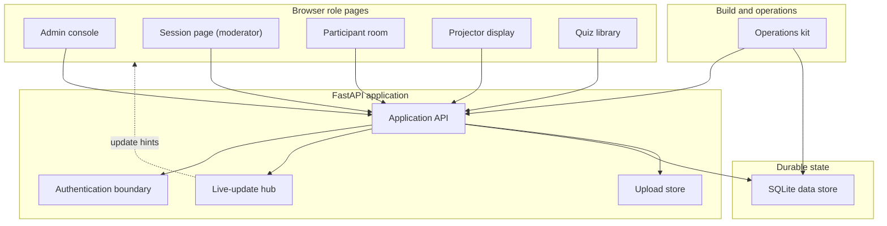
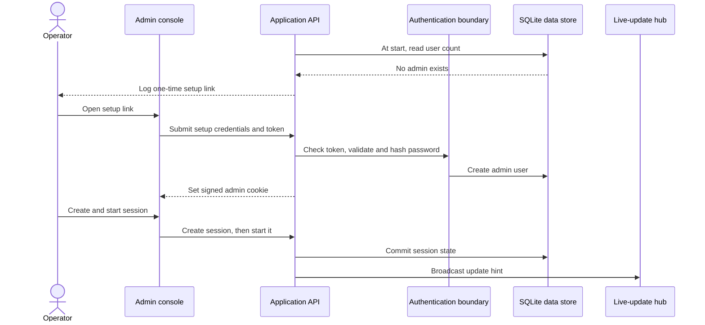
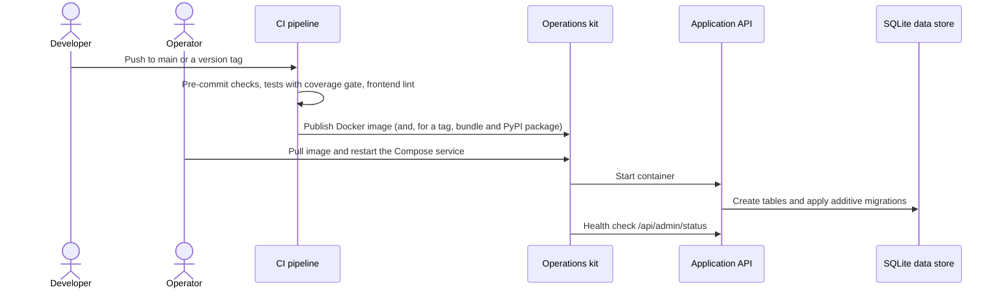
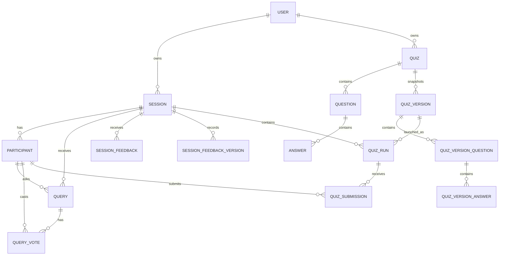

# Prashna architecture

This document describes how Prashna is built and why. The behaviour contract
is [`specs.md`](specs.md); the UI rules are in [`UX.md`](UX.md); contributor
setup, commands, and the environment-variable table are in
[`development.md`](development.md).

## Overview

Prashna is one FastAPI application. It serves the browser role pages, the JSON
API, WebSocket update hints, uploaded images, and the built Vite frontend.
Durable state is one SQLite database file plus one uploads directory. The
application runs as a single process.

Responsibilities divide as follows:

- The browser pages render workflows. They recover state by refetching over
  HTTP after an update hint or a reconnect.
- The application validates input, authorizes callers, changes state,
  serializes responses, and returns safe error messages.
- SQLite and the uploads directory persist state and files.
- The operations kit (CLI, Docker image, Compose files, nginx configuration,
  CI workflow) builds, configures, deploys, and checks the application.

Distributed live updates, a migration framework, hosted telemetry, dashboards,
alerts, and multi-tenant administration are outside the current design.

## Tech stack

- Backend: Python 3.11 or newer (the container image uses Python 3.12),
  FastAPI, SQLAlchemy 2 with the synchronous ORM, SQLite, and uvicorn.
- Authentication and authorization: bcrypt password hashes, `itsdangerous`
  signed admin cookies, per-session moderator keys, participant `voter_token` cookies, and in-process
  token-bucket rate limits.
- Live updates: one FastAPI WebSocket endpoint and an in-process hub with one
  room per session code.
- Frontend: Vite, TypeScript ES modules, plain HTML, one shared stylesheet,
  one entry point per role page, and no UI framework.
- Persistence: one SQLite database file and one uploads directory. In Docker,
  both are volumes.
- Verification: pytest with httpx for the API, Playwright for the browser,
  Ruff, Pyrefly, TypeScript, ESLint, Stylelint, detect-secrets, a personal-data
  check, and GitHub Actions with a 94% coverage gate.
- Distribution: a multi-architecture Docker image on GHCR, a Compose release
  bundle on GitHub Releases, and a Python package on PyPI that provides the
  `prashna` command.
- Production: Docker Compose on one host, nginx as the TLS reverse proxy,
  Cloudflare in front, and a health check against `/api/admin/status`.

## Constraints

- Live-room correctness: a state change commits before its update hint is
  sent, and clients recover by refetching over HTTP.
- Historical integrity: quiz runs reference immutable quiz-version snapshots,
  so editing a quiz never changes a past run's report.
- Deployment simplicity: one process, one SQLite file, one uploads directory,
  and one in-memory live-update hub.
- Explicit security boundaries: admin cookies, moderator keys, participant
  tokens, upload limits, security headers, and rate limits.
- Small codebase: large rewrites, a frontend framework, distributed pub/sub, a
  migration framework, and multi-tenant controls each need a separate,
  accepted change.

## Layers

| Layer | Responsibility | Boundary |
| --- | --- | --- |
| Browser role pages | Render the admin, moderator, participant, projector, and quiz-library workflows. | Depend on same-origin HTTP, WebSocket hints, browser storage, and static assets. They own no durable state. |
| Application boundary | Serve pages, JSON routes, uploads, and the update socket; validate, authorize, serialize, and return safe errors. | Commits state changes, then publishes update hints through the live-update hub. |
| Live-room rules | Session lifecycle, participant identity, Q&A ranking, feedback aggregation, quiz validation, quiz-version capture, quiz-run transitions, result tallies, and display state. | Live inside the route module; verified through API and browser tests. |
| Durable state | Users, sessions, participants, questions, feedback, quiz templates, quiz versions, quiz runs, submissions, indexes, migrations, and upload references. | Reached through SQLAlchemy sessions and upload file paths. |
| Build, release, and operations | Local commands, CI checks, image build, Compose deployment, nginx, configuration, health checks. | Controls how the application is built, configured, and deployed. |

## Components



- **Admin console** (`/`): first-run setup, admin sign-in, the owner's session
  list, and owner actions.
- **Session page** (`/m/<code>`): live-room control for the owning admin and
  for delegate moderators: lifecycle, invite, quiz runs, Q&A triage, attendee
  profiles, and feedback.
- **Participant room** (`/s/<code>`): anonymous identity, the optional
  attendee profile and photograph, questions, votes, quiz answers, and
  feedback when the moderator opens rating.
- **Projector display** (`/p/<code>`): public join details and the current
  room state.
- **Quiz library** (`/quizzes`): reusable quiz templates, images, validation,
  publishing, and run reports.
- **Application API** (`prashna/main.py`): routes, validation, commits,
  serialization, and update hints.
- **Data export** (`prashna/export.py`): builds owner-only downloads of
  sessions, quiz runs, and quiz templates as one JSON document or one Excel
  workbook (XlsxWriter) with one sheet per table.
- **Authentication boundary** (`prashna/auth.py`, `prashna/ratelimit.py`):
  admin cookies, moderator keys, participant tokens, password checks, and
  throttling.
- **Live-update hub** (`prashna/ws.py`): WebSocket rooms and hint delivery.
- **SQLite data store** (`prashna/db.py`, `prashna/models.py`): relational
  persistence and the additive migration bridge.
- **Upload store**: bounded image writes and `/uploads` serving.
- **Operations kit**: the `prashna` CLI (`prashna/cli.py`), backup and restore
  (`prashna/backup.py`), the install scripts (`prashna/installers/`), the
  Dockerfile, `compose.yaml`, `deploy/`, the CI workflow, and
  `performance/measure.py`.

## Interfaces

- **Same-origin HTTP API.** Browser pages call page routes and JSON routes
  under `/api/*`. Admin routes need the signed `prashna_admin` cookie.
  Moderator routes accept the owner's cookie or the `X-Mod-Key` header.
  Participant routes resolve the `voter_token` cookie and issue one when it is
  missing.
- **Session update socket.** Pages connect to `/ws/sessions/{code}`, receive
  small `{"type": ...}` hints, and refetch authoritative state over HTTP.
- **SQLite persistence.** Route handlers use SQLAlchemy sessions. Every
  connection enables foreign keys, WAL journaling, a 5000 ms busy timeout, and
  `synchronous=NORMAL`.
- **Image uploads.** Admins upload quiz images through `POST /api/uploads`.
  Participants upload a profile photograph through
  `POST /api/sessions/{code}/me/photo` without an admin login. Both paths use
  one helper with the same extension allowlist and 5 MB cap, and both return
  a `/uploads/<uuid>.<ext>` URL. A participant's previous photograph file is
  deleted when it is replaced or cleared, and when its session is deleted.
- **Data export.** `GET /api/export/all`, `/api/sessions/{code}/export`,
  `/api/quiz_runs/{id}/export`, and `/api/quizzes/{id}/export` take
  `format=json|xlsx` (and `part` for a session) and return an attachment.
  They need the owner's admin cookie; the moderator key never reaches them.
- **Static assets and media.** FastAPI serves the built Vite output from
  `prashna/static` at `/static`, and uploaded files at `/uploads`.

## Core and shell

The code uses one route module rather than a layered package layout. The
separation is by responsibility:

| Area | Classification | Test focus |
| --- | --- | --- |
| Admin console | Presentation and orchestration | Authentication and owner workflows |
| Session page | Presentation and orchestration | Delegated room controls |
| Participant room | Presentation and orchestration | Q&A, quiz, profile, and feedback flows |
| Projector display | Presentation | Public read-only state and accessibility |
| Quiz library | Policy and presentation | Template validation and version history |
| Application API | Application shell | Route contracts, commits, broadcasts, and errors |
| Authentication boundary | Policy and shell | Cookie, password, key, token, and rate-limit checks |
| Live-update hub | Adapter shell | Socket fan-out, reconnect, and refetch |
| SQLite data store | Data infrastructure | Persistence, migrations, and history |
| Upload store | Adapter shell | Upload limits, file writes, and serving |
| Operations kit | Infrastructure | Build, CI, deployment, health, and docs checks |

Core rules are authorization predicates, participant resolution, serializers,
quiz publishability checks, quiz-version capture, quiz-run transition checks,
Q&A visibility rules, feedback aggregation, result tallies, and the migration
bridge.

Shell adapters are the FastAPI route functions, cookie and header
dependencies, SQLAlchemy sessions, WebSocket accept and send calls, upload
file I/O, static-file serving, Docker Compose, and GitHub Actions.

Route handlers may orchestrate HTTP dependencies and commits. Business
behaviour must stay verifiable through the API and browser tests that cite
use-case IDs from `specs.md`.

## Key flows

Admin bootstrap and session start:



Live Q&A and refetch:

```mermaid
sequenceDiagram
  actor Participant
  actor Moderator
  participant Room as Participant room
  participant Cockpit as Session page
  participant API as Application API
  participant Data as SQLite data store
  participant Live as Live-update hub

  Participant->>Room: Submit question
  Room->>API: Create question
  API->>Data: Persist query
  API->>Live: Broadcast Q&A hint
  Live-->>Cockpit: Update hint
  Cockpit->>API: Refetch questions
  Moderator->>Cockpit: Mark responded
  Cockpit->>API: Respond to question
  API->>Data: Commit response
  API->>Live: Broadcast Q&A hint
  Live-->>Room: Update hint
  Room->>API: Refetch questions
```

Quiz launch, snapshot, and results:

```mermaid
sequenceDiagram
  actor Admin
  actor Moderator
  actor Participant
  participant Library as Quiz library
  participant Cockpit as Session page
  participant API as Application API
  participant Data as SQLite data store
  participant Display as Projector display

  Admin->>Library: Publish valid quiz
  Library->>API: Save template state
  API->>Data: Persist editable quiz
  Moderator->>Cockpit: Queue quiz in session
  Cockpit->>API: Launch ready quiz
  API->>Data: Capture or reuse quiz version
  API->>Data: Create quiz run
  Participant->>API: Submit answer
  API->>Data: Persist submission
  Moderator->>Cockpit: Reveal results
  Cockpit->>API: Reveal current question
  Display->>API: Refetch public quiz state
```

Release and startup migration:



## Data model



| Entity | What it is |
| --- | --- |
| `User` | An admin: username, password hash, session version, and creation time. First-run setup creates one password admin. Databases created by earlier releases may also contain an unused, nullable `github_id` column with its unique index; the application neither reads nor writes it. A row with an empty password hash cannot sign in. |
| `Session` | A live event: code, title, moderator key, owner, status, participant base URL, feedback-enabled flag, and timestamps. Lifecycle: `planning → live → ended`. The UI labels `planning` as "Not started". |
| `Participant` | A per-session anonymous identity keyed by the `voter_token` cookie. It holds the optional attendee profile (display name, email, contact number, organization, role, LinkedIn URL, current work, learning goal), an optional photograph URL, and first-seen and last-seen times. The profile is a contact card: no page, API response or export links it to the participant's questions, quiz answers or feedback (the anonymity rule in `specs.md`). |
| `Query` and `QueryVote` | A Q&A entry with text, an optional response, a soft-removal time, its participant, and the name the asker chose to show (`author_name`, usually empty); one vote row per participant. |
| `SessionFeedback` and `SessionFeedbackVersion` | A participant's current rating and comments, plus an immutable row for every submission. |
| `Quiz`, `Question`, `Answer` | The editable quiz template tree: owner, status, last-edited time, prompt text, optional image URLs, single or multi choice, graded flag, answer correctness, and order. Quiz lifecycle: `draft → ready`. Editing a `ready` quiz keeps it `ready`; if the edit breaks a publish rule, the quiz lists report it as `problem` ("Needs fixing") and it can't be added to a session until fixed. |
| `QuizVersion`, `QuizVersionQuestion`, `QuizVersionAnswer` | Immutable, denormalized snapshots of a quiz. A launch captures a new version only when the quiz changed since the latest version. |
| `QuizRun` | One playthrough of a `QuizVersion` inside a `Session`: status, current question index, reveal and live-count flags, and timestamps. Lifecycle: `queued → live → closed`. At most one run per session is `live`, enforced by the partial unique index `uq_session_live_run`. |
| `QuizSubmission` | A participant's selected answer for a question in a run. |
| `Setting` | An instance-wide value the admin can change, stored as JSON text by key. The `limits` row holds the adjustable rate limits (UC-A-31); the server loads it at start and keeps it in memory. |
| Upload files | Image files stored outside SQLite and referenced by URL from quiz questions, answers, or participant photographs. |

Two pairs of names are easy to confuse:

- `Question` is a quiz-template question. `Query` is a Q&A board entry.
  The participant-facing copy calls a `Query` a "question"; code, routes,
  and columns keep the name `query`.
- `QuizRun` is one playthrough of a quiz. `Session` is the gathering that
  contains runs.

`init_db()` runs at startup. It calls SQLAlchemy `create_all`, then the
additive SQLite migration bridge in `prashna/db.py` adds the known
post-deploy columns and indexes to an existing database. It records a
`db.migration` diagnostic only for a column or index it actually adds. A
change that adds
a column or index to an existing table extends that bridge and adds an
old-shape SQLite regression test. A non-additive schema change needs an
explicit release plan or a migration tool (see [`todo.md`](todo.md)).

Deleting a session or quiz removes its child rows through cascade
relationships and `ON DELETE CASCADE` foreign keys.

## Live updates

Every state-changing route commits, then calls
`broadcast_session(session, "<kind>")`. Clients treat the kind as a hint to
refetch; the socket never carries model state. The kinds are listed in
UC-X-01 of [`specs.md`](specs.md).

The hub sends to all sockets in a room concurrently, with a per-send timeout
of 2 s (`PRASHNA_WS_SEND_TIMEOUT_SECS`). A stalled receiver does not block the
API response, and a failed socket is removed from the room. Clients reconnect
with exponential backoff and refetch after each reconnect.

## Diagnostics

The application emits structured operator diagnostics through the Python
`prashna` logger (`prashna/diagnostics.py`). Each record carries a
`diag_event` name plus safe context such as outcome, route area, row ids,
session code, and upload size or extension. The helper drops any field whose
name contains `password`, `secret`, `token`, `key`, or `cookie`, and cuts
string values to 120 characters. Call sites do not log participant contact
fields, uploaded bytes, filenames, or user-entered Q&A text.

Each event is written once. When a logging handler is configured (the
compose command's `logging.basicConfig`, or uvicorn's handlers), the
`prashna` logger writes through it; only when none is configured (a plain
`uvicorn prashna.main:app`) does the helper print the line to standard
error itself. State changes made by a signed-in admin, including session
start, end, and opening or closing the rating, carry the admin's
`actor_id`; a delegate's carry none.

Diagnostics go to the process log stream, which is what the containers
record. The `prashna` command sends them to `prashna.log` in its data folder
instead, so the presenter's terminal stays readable. Prashna does not store
them in SQLite. Log retention for production is in
[`deploy/README.md`](../deploy/README.md#logs-and-retention).

## Design decisions

### Single-process runtime

- Decision: one FastAPI process, one SQLite database, one uploads directory,
  one in-memory live-update hub, and in-process rate limiting.
- Alternatives: split services with Redis pub/sub; a managed relational
  database; several FastAPI workers.
- Rationale: fits the 100-person room target with little operator effort.
- Consequence: horizontal scale and distributed live updates need a new
  design (see [`todo.md`](todo.md)).
- Revisit when: rooms regularly exceed the single-process target, or hosted
  multi-tenant operation is approved.

### Hint, then refetch

- Decision: WebSockets carry only update hints; HTTP is the authoritative
  state interface.
- Alternatives: stream full model state through sockets; poll from every
  client.
- Rationale: reconnects, missed messages, and client recovery stay simple.
- Consequence: clients refetch more often, and state stays easy to validate.
- A page must never stay deaf without noticing. A projector once stopped
  updating mid-quiz: a socket can be evicted for a slow send, or die without
  closing, while the page still believes it is connected. So the hub closes
  every socket it evicts, every page pings every 25 s and replaces a socket
  silent for 60 s, and the projector also refetches every 5 s while a quiz
  run is live (UC-X-01, UC-D-05). Do not remove the projector refresh as
  redundant; it is the backstop when both other mechanisms fail.
- Revisit when: refetch load breaks the interaction-latency or room-size
  targets in [`specs.md`](specs.md#quality-targets).

### One command to share over the internet

- Decision: `prashna --tunnel cloudflare|ngrok` starts the tunnel, reads its
  address, and makes it the default for every participant link and QR code
  (UC-X-15, UC-A-06). The server learns the address internally; there is no
  user-facing public-URL setting.
- Alternatives: a `--public-url` option or `PRASHNA_PUBLIC_URL` setting for
  addresses Prashna does not start itself (same-Wi-Fi rooms, a named tunnel,
  a reverse proxy).
- Rationale: those cases are rare, and the per-session Base URL already
  covers them; a tunnel the user never configures needs no option.
- Consequence: a same-Wi-Fi room or a self-managed tunnel needs the Base URL
  typed into each session.
- Revisit when: same-Wi-Fi rooms become common; detecting the laptop's
  network address for `--host 0.0.0.0` would then serve better than an
  option.

### SQLite with an additive startup bridge

- Decision: SQLite through SQLAlchemy, with the additive migration bridge run
  at startup.
- Alternatives: Alembic now; PostgreSQL now.
- Rationale: local and single-host operation stays direct.
- Consequence: a breaking schema change needs an explicit release or
  migration plan.
- Revisit when: data volume, concurrent writes, or schema changes outgrow the
  bridge.

### Vite multi-page frontend

- Decision: Vite multi-page TypeScript with shared helpers and one stylesheet.
- Alternatives: React, Vue, Svelte, or server-rendered templates.
- Rationale: the role pages are small, and the docs and tests already follow
  this structure.
- Consequence: shared UI patterns live in `common.ts`, `types.ts`, the
  stylesheet, and [`UX.md`](UX.md) rather than in framework components.
- Revisit when: UI complexity causes repeated maintenance problems that shared
  helpers do not solve.

### Password-only admin sign-in

- Decision: an admin signs in with a username and password, and only that
  way. The first admin is created through the one-time setup link.
- Alternatives: a third-party sign-in, such as GitHub OAuth, alongside the
  password.
- Rationale: one sign-in method keeps installation and operation simple. It
  needs no OAuth app registration, client secret, or allowlist.
- Consequence: every admin account has its own password.
- Revisit when: several admins or organisations share one server.

### Owner and delegate authority

- Decision: admin owners and delegate moderators are separate. A delegate
  holds the session's `mod_key` and has no account.
- Alternatives: moderator accounts; making every moderator a full admin.
- Rationale: delegation without account management, and owner-only controls
  stay with the owner.
- Consequence: the moderator key travels in the URL fragment and in browser
  `localStorage`, and that handling is part of the moderator client contract.
- Revisit when: teams need revocable, audited, multi-person moderation.

### Immutable quiz versions

- Decision: quiz runs launch against immutable `QuizVersion` snapshots.
- Alternatives: link runs to the editable template; copy report fields only
  when a run closes.
- Rationale: past reports never change.
- Consequence: launch-time version capture depends on the quiz's
  last-edited time being updated by every template edit.
- Revisit when: quiz authoring gains collaborative editing, imports, or media
  that change snapshot semantics.

## Risks and trade-offs

| Risk | Impact | Mitigation | Residual risk | Revisit when |
| --- | --- | --- | --- | --- |
| First-run setup exposure | If the address is public before setup, the wrong person could claim the admin account. | Setup needs a one-time token that appears only in the server log, in an operator-set `PRASHNA_SETUP_TOKEN`, or in the `setup-token` file beside the database. The token is retired once an admin exists. | Anyone who can read the server log or data folder before setup can create the admin. | A server log or data folder leaks before setup completes. |
| Limited upload validation | Extension and size checks do not prove that a file is a safe image. Participants can upload profile photographs without an admin login. | 5 MB cap, extension allowlist without SVG, random file names, and an isolating CSP, `nosniff`, and `Cross-Origin-Resource-Policy` on `/uploads`. Photograph uploads are rate-limited per person (UC-X-08), and a photograph's file is removed when it is replaced or cleared, or when its session is deleted. Content sniffing is a deferred decision in [`specs.md`](specs.md#deferred-decision-needed). | Anyone with a session code can store images of up to 5 MB each. | Upload volume or abuse appears, or authoring opens to less-trusted users. |
| Narrow migration bridge | An unsupported schema change could need manual repair. | Extend the bridge and its old-shape SQLite tests for every persisted column or index. | No general migration tool. | A non-additive schema change or a data-retention commitment. |
| Single-process live hub | Several workers would split clients across separate room hubs. | Run one process, recover through HTTP refetch, and time out stalled sends. | Accepted for the current room-size target. | Several workers, several hosts, or hosted operation. |
| Room-scale performance | The 100-person room target has no automated load test. | Page-load measurement and budgets in [`performance/README.md`](../performance/README.md); server timing on every response. | Latency under a full room is unmeasured. | Before relying on rooms near the target size. |
| Operator-only diagnostics | Without dashboards or alerts, incident diagnosis relies on reading logs. | Structured, secret-safe diagnostics for authentication, setup, uploads, migrations, lifecycle, and page performance. | No hosted telemetry. | Recurring live-event incidents or hosted support obligations. |
